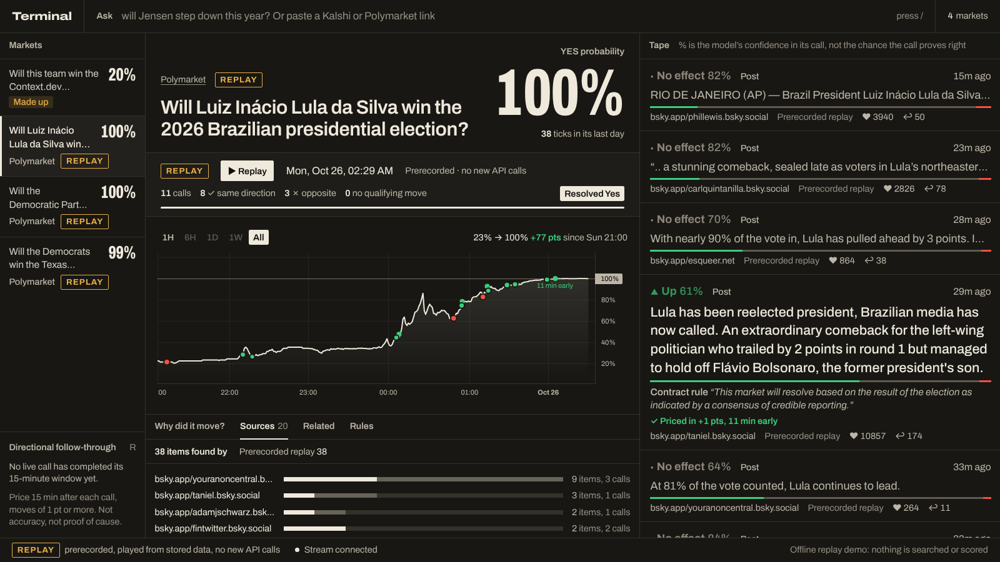
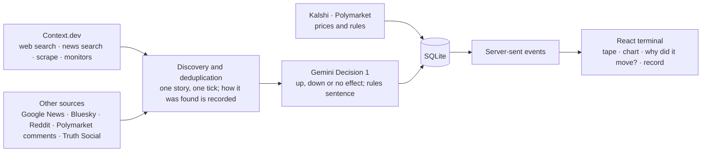

# Terminal

**Terminal turns the live web into sourced explanations for prediction-market movements.**

When a prediction market moves, an analyst has to search the news, the social posts and the contract's own
rules by hand to work out why. Terminal does that as it happens: it watches the web for each market, scores
every new article and post for which way it should move the price of YES, shows the passage and the rules
sentence behind each call, and when the price jumps it names the likeliest explanation among what it found.

Built at Junction 2026 for the Context.dev challenge: a product that reacts to the live web. It reads public
data only and places no trades.



*The offline replay demo (`?presentation=1`): a finished Polymarket market played back from stored data. It
is tagged REPLAY everywhere; nothing on it was found or scored live.*

**Quick links:** [Offline replay demo](#offline-replay-demo) · [Live setup](#run-it-live) ·
[Context.dev integration](#contextdev-integration) · [Evaluation methodology](#evaluation-methodology) ·
[Presentation script](docs/PRESENTATION.md)



## Limitations

- **A likely explanation is not proof of causation.** When a price jumps, the model picks the best match
  among the items the terminal found. The same news reaches traders by other roads, and prices move for
  reasons nobody posted.
- **Directional follow-through is not trading accuracy.** It counts how often the price moved the called
  way within 15 minutes of a call. Nothing was bought or sold, and a market drifting one way flatters
  every call made that way.
- **Synthetic (made-up) markets are illustrative.** Their price is nudged by model-scored input and is not
  a real market forecast. They are tagged as made up wherever they appear.
- **Replay results are separate from live results.** Replays are prerecorded, tagged REPLAY, and never
  counted in the live record or in the measured latency.

## Offline replay demo

One command starts the real backend and the built screen with the three bundled replays. It needs no API
key and makes no outside request: nothing is polled, searched or scored.

```sh
uv run python -m terminal.offline
# then open http://127.0.0.1:18912/?presentation=1
```

- The screen is built on the first run if `ui/dist` is missing (this step needs Node.js and, once, the
  npm registry). After that the demo runs with the network unplugged.
- It keeps its own store in a temporary folder, deleted on exit, so a live terminal's `terminal.db` is
  never touched. `--db PATH` keeps the store at a path of your choice; `--port` moves it off 18912.
- Every write is refused (`503`), so no Gemini or Context.dev call can be made from it. The made-up market
  is listed but takes no sentences: there is no scorer offline, and none is imitated.
- Replays stay tagged REPLAY in the market list, the header, the replay bar and the status line.

## Presentation mode

Add `?presentation=1` to the address of either the offline demo or the live terminal:

| Address | What it does |
| --- | --- |
| `/?presentation=1` | Larger type scaled to the window, a wider tape, and it opens on a populated real market when there is one, else on a populated replay. It never opens on the empty made-up market, which stays in the list for the closing interaction. |
| `/?presentation=1&market=<market-id>` | The same, opening on that market (ids are in `GET /markets`, for example `replay-lula`). `?market=` also works without presentation mode. |

Nothing starts by itself: a replay waits for its Replay button (or Space), the microphone for Space on the
made-up market, and no sound is played. Without the parameter the screen behaves as before.

Keys: `1`-`9` pick a market, `Space` plays or stops a replay (and toggles the mic on the made-up market),
`W` opens "Why did it move?", `R` opens the record, `/` focuses the question box, `Esc` closes.

## Context.dev integration

Context.dev is how the terminal finds and reads the live web. These are the endpoints the code calls
(`terminal/contextdev.py`), and what each one puts on the screen:

| Endpoint | What it is used for | Where it shows |
| --- | --- | --- |
| `POST /web/search` | Finds market-relevant pages and posts: every query of a market on every pass, restricted to the last 24 hours, with the passages of each page that match the query (`highlightsOptions`). Also finds the venue market for a question asked in plain words, and the page worth monitoring. | Ticks tagged "Found via Context.dev web search", with the passage quoted under the headline; the cards shown while a question is matched to a market. |
| `POST /news/search` | Fresh news about the companies a market is about, filtered by publish time. | Ticks tagged "Found via Context.dev news", with their publish time. |
| `POST /web/scrape` | Reads a page found a moment ago: its main text for the scorer and its publish time. Sent with `maxAgeMs: 0`, so the page is fetched fresh, not from a cache. | The "published … ago" time on article ticks, and better-informed verdicts. |
| `POST /batch/submit`, `GET /batch/{id}` | Reads the publish times still missing on shown articles, in one batch a minute. The cache is left on here: a publish time does not change. | "published … ago" appearing on a tick a little after it lands. |
| `POST /monitors`, `DELETE /monitors/{id}`, signed webhooks | Optional: one page per market watched for changes every ten minutes, each change delivered to a signed webhook and scored. Needs a public address (`PUBLIC_URL`), so it is not part of the offline demo and the main demo does not depend on it. | Ticks tagged "Found via Context.dev monitor", and the "Watched page" row in the Sources tab. |

**Provenance is recorded, not inferred.** Every tick stores how it was found (`provenance`), apart from who
published it (`source`). Only items Context.dev found are labelled as such; Google News, Bluesky, Reddit,
Polymarket comments, Truth Social, spoken and typed lines and replays are each labelled as themselves, and
ticks stored before this was recorded say "not recorded". When two ways find the same item in one pass it
is one tick, credited to one way by a fixed priority (`PROVENANCE` in `terminal/db.py`). The Sources tab
counts a market's items by how they were found.

**Freshness.** Search runs against the live web when asked and is limited to the last 24 hours
(`freshness`); the news index is filtered by publish time; a page read at discovery is fetched fresh
(`maxAgeMs: 0`). No cache parameter is sent to search or news: the documentation gives none for the parts
of those endpoints used here.

**Measured latency.** Each live tick stores when it was published (where known), when it reached the
terminal and when it had been scored. `GET /metrics` reports the median and 95th percentile of
publication-to-discovery and discovery-to-scored over the last day, plus the durations of recent
Context.dev and Gemini requests. The status line at the foot of the screen shows them. Replays, made-up
markets, spoken and typed ticks and backfill are left out, and with fewer than five ticks no figure is
given at all.

## Evaluation methodology

The record (press `R`, or `GET /record`) measures **directional follow-through**: for each up or down call
on a real, live market, the price 15 minutes later is compared with the price at the call.

| Count | Meaning |
| --- | --- |
| `calls` | up or down calls whose 15-minute window is over |
| `evaluable` | of those, followed by a price move of at least 1 point (`min_move_points`) |
| `same_direction` | the price moved the way the call said |
| `opposite_direction` | the price moved the other way |
| `no_qualifying_move` | the price moved less than 1 point |
| `markets` | distinct real markets the calls were made on |
| `window_seconds`, `start`, `since` | the window, where counting starts, and the first tick after that |

`calls = evaluable + no_qualifying_move` and `evaluable = same_direction + opposite_direction`. The screen
always shows the share with its denominator ("Of 97 calls followed by a qualifying price move, 71 moved in
the predicted direction" is the form; the numbers are whatever the store holds), with the opposite and
no-move counts beside it.

Left out: made-up markets, replays, spoken and typed ticks, backfill (history found on a market's first
pass, or a page more than a day old), and calls made when the market had no price to stand on. Counting
starts on 14 Nov at 15:53 UTC, when the scorer began to be told each item's age.

This measures association with later price movement. It does not show that an item caused a move, and it
is not accuracy, a win rate or a trading result. A replay shows the same counts for its own calls at the
end of its playback, kept apart from the live record.

## How it works

Every item takes the same path: found, deduplicated, scored, stored, streamed to the frontend.

| Step | What happens | Where |
| --- | --- | --- |
| Find | News through Context.dev web search, every query of a market on every pass, for markets about a company through Context.dev's news index, and through Google News feeds (the last two hours only); both are minutes behind the publishers. One story is one tick, whichever outlet or search it came from. Posts on X and Reddit through the same search, plus the newest posts of subreddits that were relevant before. The newest comments under the market on Polymarket (its own, or the same question's there), as posts. The day's most-liked Bluesky posts for each query, from Bluesky's own search: no login, exact post times, and a post cannot be edited afterwards. Trump's Truth Social posts within about 30 seconds, from the scraper in `trump-social-scraper/`. | `terminal/poller.py`, `terminal/posts.py`, `terminal/truth.py` |
| Filter | An item is looked at once per market. Replies, link-only posts, posts nobody liked, recurring Reddit threads and removed posts are kept off the tape without a model call; so are Polymarket comments that are replies, reported, under eight words or adverts. A Bluesky post is read only once it has 20 likes, is not a reply and says eight words; until then it is passed over, not stored, since it may yet be liked. | `terminal/posts.py` |
| Score | Gemini Decision 1 is told the market, its rules, the current price, the rival contracts, what was already reported and how old the item is (a venue's traders are taken to have priced anything older than an hour or two), then asked how far the new item should move the price and whether it is news at all. For a tick that moves the price it also picks the sentence of the rules that makes the item matter. | `terminal/scoring.py`, `terminal/pipeline.py`, `terminal/rules.py` |
| Store and stream | SQLite, and one server-sent-events stream for the frontend. | `terminal/db.py`, `terminal/api.py` |

It also works backwards, from the price to the web: when a real market's price jumps 3 points within
10 minutes, the terminal searches for that market at once and Decision 1 names the item most likely
behind the jump, with the sentence of the rules it touches, or says that no news explains it and which
related contracts moved at the same time. The same can be asked of any market's last day on request
(`terminal/moves.py`).

Each market also has one page watched for it by a Context.dev monitor: the page most likely to change
when the outcome is decided (a newsroom, a results page, a Wikipedia article), found by search and chosen
by Decision 1. Context.dev checks it every ten minutes and calls a signed webhook; a change that bears on
the market becomes a tick (`terminal/pages.py`). This needs an address the internet can reach (`PUBLIC_URL`).

A question in plain words is matched to a real market by searching both venues and letting Decision 1 pick
(`terminal/match.py`). When the other venue lists a contract that resolves the same way (the same person,
threshold and deadline, as Decision 1 judges it), the two are paired and the market carries a `consensus`:
both venues' prices, their middle and how far apart they are. When nothing matches, a text model writes a yes/no question with a deadline, Decision 1
gives its starting odds from the coverage found, and each shown tick afterwards nudges the price
(`terminal/madeup.py`, `terminal/pricing.py`).

A market tracked just now starts with the venue's last week of prices, about one an hour
(`terminal/venues/`), so its chart is not empty and the news found for it has a price to stand on.
From then on the terminal samples the price itself.

**Replays.** Three finished markets can be played back on the screen (the Replay button, or Space): Lula's
runoff night, control of the US Senate, and the Texas Senate race. Each is the market's real prices, one
a minute, and the most-liked Bluesky posts of every half hour of those hours, each scored the way a live
post is: the model is told the date, the price at that minute and the posts before it, and nothing later.
The tape then judges every call against the price 15 minutes on, as it does live. Posts and not news
pages, because a post cannot be edited: a news page's headline is rewritten once the result is known,
which would hand the model the ending. `scripts/make_replay.py` builds them into `replays/`, and the
service loads that folder when it starts (`terminal/replay.py`); nothing polls or changes a replay, and
its calls stay out of the live record and the measured latency. Rebuild them with

    PYTHONPATH=. uv run --env-file .env python scripts/make_replay.py

Prices are percentages from 0 to 100 and times are unix seconds, everywhere.

## Run it live

For the offline replay demo, which needs no keys, see [above](#offline-replay-demo). The live terminal:

Python 3.12 or newer and [uv](https://docs.astral.sh/uv/).

```sh
cp .env.example .env          # fill in the keys; see the comments in the file
uv run --env-file .env uvicorn terminal.api:app --port 18911
uv run --env-file .env python scripts/seed_markets.py http://127.0.0.1:18911   # tracks the markets in markets.txt
```

The real screen is the React app in `ui/`. Built once, the terminal serves it at http://127.0.0.1:18911/
(build it again after every change to `ui/`, then restart the terminal):

```sh
(cd ui && npm ci && VITE_API_URL= npm run build)   # an empty VITE_API_URL: the screen talks to the address it came from
```

Open http://127.0.0.1:18911/?presentation=1 to present from it (see [Presentation mode](#presentation-mode)).

http://127.0.0.1:18911/debug is a plain debug page: ask a question, pick a market, type a sentence and
watch it become a tick. It is also what `/` shows until the screen is built.

| Variable | Meaning |
| --- | --- |
| `GEMINI_API_KEY` | Google AI key with access to `gemini-decision-1` and the text model |
| `CONTEXT_DEV_API_KEY` | one Context.dev key, or several separated by commas; each adds its own per-minute allowance |
| `CONTEXT_DEV_RPM` | requests a minute the terminal allows itself per key (default 10): set it to your plan's per-minute limit. This is a rate, not a concurrency limit: how many requests may be in flight at once is a separate limit on Context.dev's side, and the terminal bounds its own parallelism apart from this (ten items scored at once per market, four markets searched at once) |
| `TERMINAL_KEY` | shared secret that every write must send in an `X-Terminal-Key` header |
| `DB_PATH` | the SQLite file |
| `GEMINI_TEXT_MODEL` | the model that writes search queries and made-up questions |
| `GEMINI_SPEECH_MODEL` | optional: the model that writes down what the microphone hears (same key); `GEMINI_TEXT_MODEL` when unset |
| `TRUTH_FEED` | optional: the file `trump-social-scraper` appends new posts to |
| `PUBLIC_URL` | optional: the address the internet reaches this service at; turns on page watching, since Context.dev calls back `PUBLIC_URL/hooks/context/...` |

## Interface

Reads are open; writes need the `X-Terminal-Key` header. The full description, with the shape of a tick
and of every stream event, is in
[the design document](docs/superpowers/specs/2026-11-13-terminal-design.md#interface-for-the-frontend).

| Request | What it does |
| --- | --- |
| `GET /markets`, `GET /markets/{id}` | tracked markets with price, 24-hour change and ticks today; one market with its related contracts, sources and watched page |
| `POST /markets` | track a market from a link or from plain words |
| `DELETE /markets/{id}` | stop tracking a market (the venues are also asked every ten minutes which markets have resolved, and those are dropped the same way) |
| `POST /markets/mu-demo/reset` | put the demo market back to its starting price with an empty tape |
| `GET /markets/{id}/ticks`, `GET /markets/{id}/prices` | history for the tape and the chart |
| `GET /markets/{id}/moves` | "why did it move?": the market's price moves, each in one sentence with its likely explanation |
| `POST /markets/{id}/why` | explain the market's move over the last day, now |
| `POST /markets/{id}/pair` | look for the same question on the other venue; found, the two prices are shown as one `consensus` |
| `POST /markets/{id}/ticks` | a spoken or typed sentence, scored like any other tick |
| `GET /stream` | server-sent events: `tick`, `tick_update`, `price`, `move`, `market`, `page_check` |
| `GET /record` | directional follow-through: every count behind how often the price moved the called way (see [Evaluation methodology](#evaluation-methodology)) |
| `GET /metrics` | measured latency of live ticks over the last day, and whether this is the offline demo; figures are null until there are enough ticks |
| `GET /status` | Context.dev use and credits per key (needs the key) |

## Deploy

Two systemd user services, in `deploy/`: `terminal.service` runs the terminal, and `trump-scraper.service`
runs the Truth Social scraper, which needs the one-time setup in
[its own README](trump-social-scraper/README.md).

```sh
ln -s "$PWD"/deploy/*.service ~/.config/systemd/user/
systemctl --user daemon-reload && systemctl --user enable --now terminal trump-scraper
```

Watched pages cost one Context.dev credit per page every ten minutes for as long as their monitors exist,
whether or not the terminal is running. To stop them all:

```sh
PYTHONPATH=. uv run --env-file .env python scripts/stop_monitors.py data/terminal.db
```

The unit files hold absolute paths for the machine they were written on; change them for another one.

## Tests

```sh
uv run pytest                                                     # the terminal; no network needed
(cd trump-social-scraper && python -m unittest test_trump_scraper)  # the scraper
```
